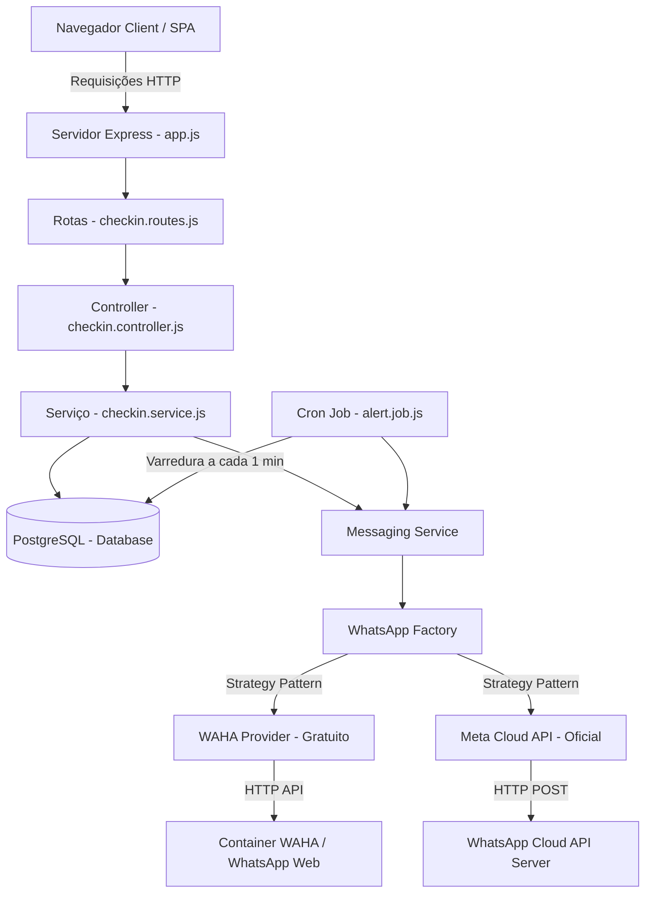

# 🧒 Kids9 Backend & Frontend System

O **Kids9** é um sistema completo e moderno de check-in, monitoramento e controle de tempo para espaços de lazer infantis (como brinquedotecas, parquinhos de shopping e áreas de recreação). 

O sistema oferece controle em tempo real da ocupação do espaço, faturamento diário, liberação de crianças segura via código PIN por WhatsApp (usando o padrão **Strategy** para suportar múltiplos provedores) e notificações automatizadas de tempo restante via **Cron Jobs**.

---

## 📋 Funcionalidades Principais

*   **📱 Portal do Operador (Mobile SPA):**
    *   Fluxo ágil de check-in com cadastro do nome da criança, telefone do responsável, atração, tempo contratado e valor pago.
    *   Criação automática de um código PIN aleatório de segurança para liberação de checkout.
    *   Envio automático do PIN por WhatsApp ao responsável assim que o check-in é salvo.
    *   Painel visual das crianças ativas com barra de progresso da ocupação atual baseada na capacidade configurada.
    *   Busca rápida de crianças ativas por nome.
    *   Checkout seguro exigindo o PIN do responsável ou com liberação manual de supervisor (Bypass por PIN administrativo `4321`).
*   **📺 Painel da TV Pública (Painel de Monitoramento):**
    *   Interface de alta visibilidade projetada para telas de monitoramento ou TVs no espaço de lazer.
    *   Grid responsivo exibindo o tempo restante de cada criança em tempo real.
    *   Indicação de status por cores:
        *   🟢 **No prazo** (Tempo restante seguro)
        *   🟡 **Atenção** (Faltando menos de 10 minutos)
        *   🔴 **Tempo Esgotado / Acabando** (Faltando menos de 5 minutos ou vencido)
    *   Barra de alerta dinâmica no rodapé que rola e exibe em destaque o nome das crianças cujos tempos estão prestes a acabar.
    *   Mascaramento de números de telefone para conformidade com a LGPD.
*   **📊 Dashboard Administrativo (Desktop):**
    *   Acesso restrito protegido por PIN administrativo (`4321`).
    *   Métricas de desempenho em tempo real (KPIs):
        *   Crianças ativas no momento.
        *   Faturamento diário acumulado.
        *   Ticket médio por check-in.
        *   Total de check-ins realizados no dia.
    *   Gráfico interativo de ocupação horária por hora de funcionamento (das 10h às 22h).
    *   Histórico recente de check-ins e tabela completa do histórico dos últimos 100 registros com busca por nome ou celular.
    *   Configurações gerais do sistema.

---

## 🏗️ Arquitetura do Sistema

O sistema é construído sobre uma arquitetura limpa em camadas (Controllers, Services, Providers, Config, Jobs) utilizando Node.js, Express e PostgreSQL.



---

## 🔌 WhatsApp Integration: Padrão Strategy

Para suportar flexibilidade comercial e técnica, o envio de notificações de WhatsApp foi desacoplado usando o padrão de design **Strategy**. O sistema suporta dois provedores ativos selecionáveis pela variável `WHATSAPP_PROVIDER` no `.env`:

### 1. `free` (WAHA - WhatsApp HTTP API)
*   **Descrição:** Utiliza o projeto open-source WAHA, que encapsula um cliente de WhatsApp Web em um container Docker para permitir automação sem custos por mensagem.
*   **Inicialização Dinâmica:** No startup, o provedor se conecta ao WAHA, lista as sessões ativas e associa o envio à sessão `WORKING` ativa ou cria e inicializa a sessão configurada de forma assíncrona para não travar a inicialização do Express.
*   **Simulação de Templates:** Como o WhatsApp Web não possui suporte nativo a templates de mensagens oficiais, o `WahaProvider` mapeia os identificadores de template (`template_checkin_shopping`, `template_five_min_alert`) e gera o texto correspondente de forma programática.

### 2. `official` (Meta/Facebook Cloud API)
*   **Descrição:** Utiliza a API oficial de nuvem do WhatsApp disponibilizada pela Meta. Recomendado para ambientes de produção escaláveis.
*   **Validação Estrita:** Exige chaves obrigatórias como o Token de Acesso da Meta (`META_WA_TOKEN`) e o ID do número de telefone (`META_WA_PHONE_NUMBER_ID`).
*   **Mensagens por Template:** Envia requisições formatadas em JSON correspondendo aos componentes e parâmetros registrados no painel do Meta Business Suite.

*(Nota: Ambos os provedores aplicam automaticamente a regra de normalização de números telefônicos do Brasil, incluindo o tratamento especial do 9º dígito para os DDDs 11 a 28).*

---

## ⏰ Cron Jobs de Alerta

O sistema agenda uma tarefa em segundo plano utilizando `node-cron` que roda a **cada 1 minuto** (`*/1 * * * *`). 
A tarefa realiza as seguintes ações:
1. Consulta a tabela do banco de dados em busca de registros com status `active`, que ainda não receberam o alerta (`alert_sent = FALSE`), têm menos de 3 tentativas de alerta falhas e cuja previsão de saída ocorre em no máximo 5 minutos a partir do horário atual (`expected_checkout_time <= NOW() + INTERVAL '5 minutes'`).
2. Dispara a notificação de encerramento do brinquedo (`template_five_min_alert`) pelo provedor de mensagens ativo.
3. Atualiza o banco de dados marcando o registro como alertado e incrementando as tentativas para evitar loops em caso de falha de conexão ou número inválido.

---

## 🗄️ Esquema do Banco de Dados

O banco de dados PostgreSQL contém uma tabela central denominada `checkins`. Abaixo está a estrutura dos campos:

| Campo | Tipo | Descrição |
| :--- | :--- | :--- |
| `id` | `SERIAL` (PK) | Identificador único autoincrementado do check-in. |
| `child_name` | `VARCHAR(100)` | Nome completo da criança. |
| `parent_phone` | `VARCHAR(20)` | Telefone com DDD do responsável. |
| `payment_method` | `VARCHAR(50)` | Método de pagamento (ex: Pix, Cartão, Dinheiro). |
| `payment_value` | `NUMERIC(10,2)` | Valor total cobrado. |
| `playtime_minutes`| `INTEGER` | Duração contratada em minutos (ex: 30, 60, 90). |
| `checkin_time` | `TIMESTAMP` | Data/hora de entrada (padrão: `NOW()`). |
| `expected_checkout_time`| `TIMESTAMP` | Data/hora calculada para a saída. |
| `actual_checkout_time`| `TIMESTAMP` | Data/hora em que a saída foi confirmada. |
| `pin` | `VARCHAR(6)` | Código numérico de segurança para checkout. |
| `status` | `VARCHAR(20)` | Estado do check-in (`active` ou `completed`). |
| `alert_sent` | `BOOLEAN` | Sinaliza se o alerta de 5 minutos foi disparado (`DEFAULT FALSE`). |
| `alert_attempts` | `INTEGER` | Contador de tentativas de notificação (`DEFAULT 0`). |
| `created_at` | `TIMESTAMP` | Registro automático da criação da linha. |
| `updated_at` | `TIMESTAMP` | Atualizado dinamicamente via Trigger a cada update. |

---

## ⚙️ Configuração e Instalação

### Pré-requisitos
*   Node.js (versão >= 18.0.0)
*   PostgreSQL instalado e rodando localmente ou via Docker
*   Acesso ao servidor WAHA (Docker) ou chaves da Meta API (se for usar o modo oficial)

### 1. Clonar e instalar dependências
```bash
# Navegar até a pasta do projeto
cd kids9

# Instalar dependências
npm install
```

### 2. Configurar Variáveis de Ambiente
Crie um arquivo `.env` na raiz do projeto (use o `.env.example` como guia):

```env
# Configurações do Servidor
PORT=3000
NODE_ENV=development
ADMIN_PIN=4321

# Configurações do Banco de Dados PostgreSQL
DB_HOST=localhost
DB_PORT=5432
DB_USER=seu_usuario_do_banco
DB_PASSWORD=sua_senha_do_banco
DB_NAME=kids9

# Provedor de Mensagens WhatsApp: 'free' (WAHA) ou 'official' (Meta API)
WHATSAPP_PROVIDER=free

# Se usar WHATSAPP_PROVIDER=free:
WAHA_API_URL=http://localhost:3000
WAHA_API_KEY=sua_chave_de_api_waha_se_existir
WAHA_SESSION_NAME=default

# Se usar WHATSAPP_PROVIDER=official:
META_WA_TOKEN=seu_token_da_meta_aqui
META_WA_PHONE_NUMBER_ID=seu_phone_number_id_aqui
META_WA_API_VERSION=v18.0
```

### 3. Scripts de Inicialização

*   **Inicialização do Banco de Dados:** O sistema executa o script `src/database/init.sql` automaticamente durante o bootstrap se as tabelas ainda não existirem no banco configurado.
*   **Iniciar em Desenvolvimento (Modo Watcher):**
    ```bash
    npm run dev
    ```
*   **Iniciar em Produção:**
    ```bash
    npm start
    ```

---

## 🛡️ Segurança e LGPD

1.  **Bypass Administrativo:** O checkout exige o PIN do responsável. Caso ele o perca, o operador pode acionar um bypass inserindo o PIN administrativo (`4321`). O sistema registra no console quando liberações administrativas ocorrem para auditoria.
2.  **Mascaramento de Dados:** No painel da TV Pública, que fica exposto para qualquer pessoa ver, o número de telefone do responsável é exibido no formato `(XX) X ****-YYYY` para evitar exposição de dados sensíveis em locais públicos.
3.  **Privacidade das Sessões:** As variáveis de ambiente do PostgreSQL e das chaves de API não devem ser commitadas no repositório. O arquivo `.gitignore` já exclui arquivos `.env` e pastas temporárias de tokens.
