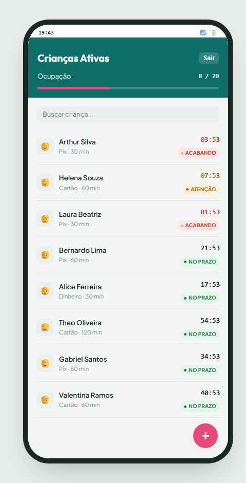
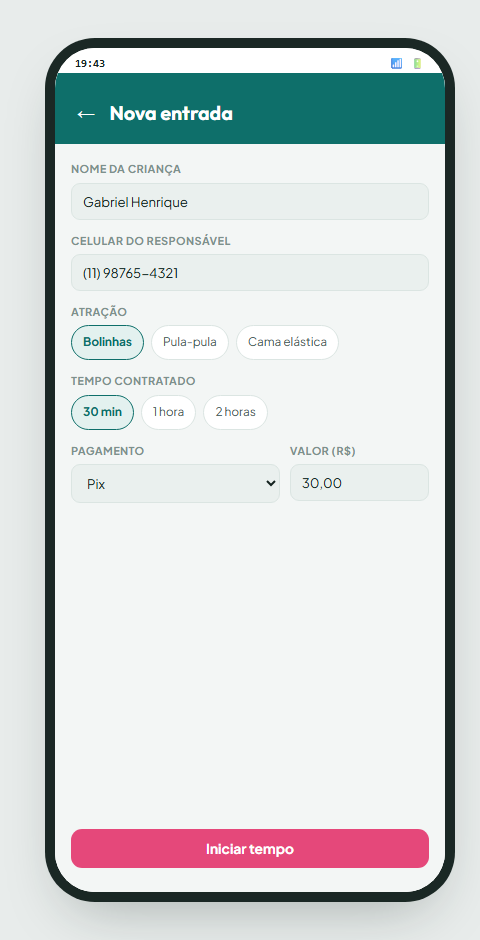
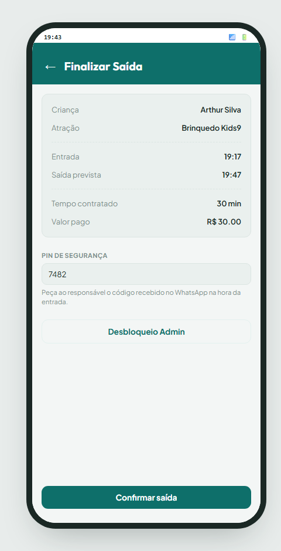
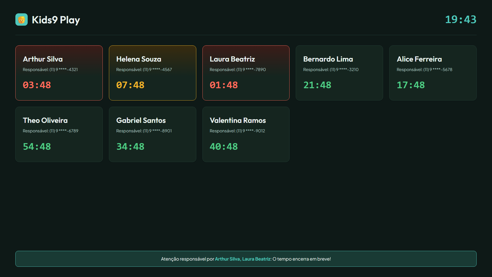
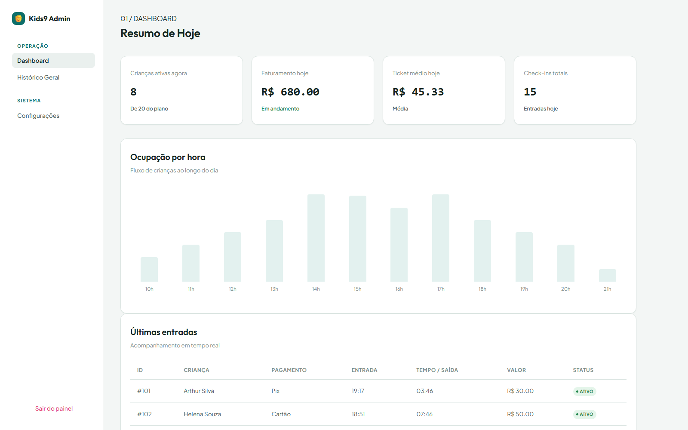
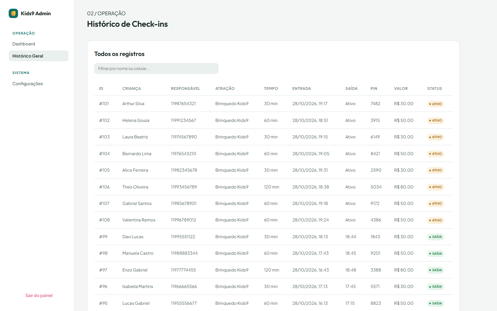
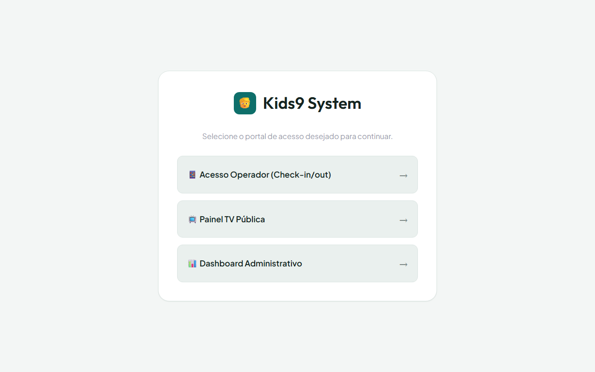
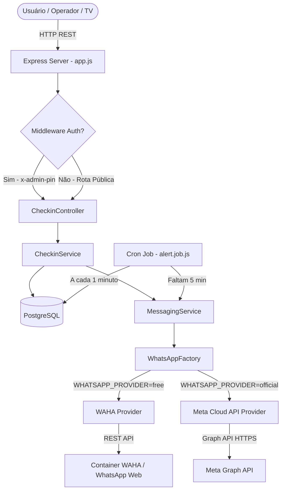

# 🧒 Kids9 — Sistema Inteligente de Gestão, Monitoramento e Segurança para Espaços Infantis

<div align="center">


<p align="center">
  <b>Sistema completo para controle de tempo, check-in ágil, liberação segura via PIN e alertas automáticos via WhatsApp para brinquedotecas, buffets e parques infantis.</b>
</p>

[Visão Geral](#-visão-geral) •
[Funcionalidades](#-funcionalidades) •
[Arquitetura](#-arquitetura-e-design-patterns) •
[Interfaces](#-telas-e-interfaces) •
[Como Rodar](#-como-rodar-o-projeto) •
[API Reference](#-endpoints-da-api) •
[Segurança & LGPD](#-segurança-e-lgpd)

</div>

---

## 🎯 Visão Geral

O **Kids9** é uma solução completa desenvolvida para modernizar a operação de espaços de recreação infantil (como brinquedotecas em shoppings, parques temáticos e buffets). O sistema resolve as principais dores desse segmento:

1. **Agilidade no Check-in:** Cadastro rápido de crianças e responsáveis sem filas.
2. **Segurança Reforçada no Checkout:** Liberação da criança exclusivamente mediante apresentação de código **PIN temporário de 4 dígitos** gerado automaticamente e enviado ao WhatsApp do responsável.
3. **Monitoramento em Tempo Real:** Painel TV interativo com contagem regressiva e alertas visuais por cores para os pais e operadores.
4. **Comunicação Ativa & Automatizada:** Disparo automático de alertas via WhatsApp quando faltam 5 minutos para o tempo expirar, reduzindo atritos por tempo excedido.
5. **Controle Financeiro e Operacional:** Dashboard administrativo com faturamento em tempo real, ticket médio e gráfico de ocupação por hora.

---

## ✨ Funcionalidades

### 📱 1. Portal do Operador (Mobile & Tablet First)
- Cadastro expresso com nome da criança, telefone do responsável com máscara brasileira e seleção de tempo contratado (30, 60, 90+ min).
- Cálculo automático do valor com base na atração e no tempo.
- Geração instantânea de PIN único de segurança para retirada.
- Disparo imediato da mensagem de boas-vindas com o PIN no WhatsApp do responsável.
- Grid de monitoramento com barra de capacidade do espaço em tempo real.
- Busca rápida por nome e filtro de status.
- Checkout seguro por PIN ou liberação supervisionada com PIN mestre de administrador.

### 📺 2. Painel da TV Pública (Monitoramento em Alta Visibilidade)
- Projetado para televisores e monitores voltados para a área externa/público.
- Cards dinâmicos com contagem regressiva em tempo real:
  - 🟢 **Verde (No Prazo):** Mais de 10 minutos restantes.
  - 🟡 **Amarelo (Atenção):** Menos de 10 minutos restantes.
  - 🔴 **Vermelho (Esgotado / Alerta):** Menos de 5 minutos ou tempo excedido.
- Ticker dinâmico no rodapé destacando nomes das crianças com tempo prestes a esgotar.
- **Privacidade (LGPD):** Mascaramento automático dos números de telefone `(XX) X ****-YYYY`.

### 📊 3. Dashboard Administrativo
- Proteção de acesso com PIN administrativo (`ADMIN_PIN`).
- **KPIs em Tempo Real:** Crianças ativas, receita diária acumulada, ticket médio e volume de check-ins do dia.
- **Gráfico de Ocupação Horária:** Distribuição do fluxo ao longo do horário comercial (10h às 22h).
- **Histórico Completo:** Tabela com busca, paginação e detalhes de entradas/saídas e meios de pagamento.

---

## 🖼️ Telas e Interfaces

### 📱 1. Portal do Operador (Mobile First)
Interface responsiva otimizada para smartphones e tablets utilizados pelos operadores e monitores no balcão de atendimento:

<div align="center">
  <table>
    <tr>
      <th align="center">Crianças Ativas & Capacidade</th>
      <th align="center">Novo Check-in Expresso</th>
      <th align="center">Checkout Seguro com PIN</th>
    </tr>
    <tr>
      <td align="center"></td>
      <td align="center"></td>
      <td align="center"></td>
    </tr>
  </table>
</div>

---

### 📺 2. Painel da TV Pública (Monitoramento em Alta Definição)
Tela Full HD (Dark Mode) desenvolvida para televisores voltados para o público externo, permitindo que os pais monitorem o tempo restante com conformidade à LGPD e avisos sonoros/visuais:

<div align="center">
  
</div>

---

### 📊 3. Dashboard Administrativo & Gestão
Visão consolidada em tempo real com métricas financeiras, gráfico de fluxo por hora e histórico detalhado para auditoria:

<div align="center">
  <p><b>Painel de Indicadores e Ocupação por Hora</b></p>
  
  <br><br>
  <p><b>Histórico Completo de Check-ins com Filtro de Busca</b></p>
  
</div>

---

### 🌐 4. Hub Central de Acesso
Portal inicial de navegação com roteamento facilitado entre os módulos do sistema:

<div align="center">
  
</div>

---

## 🏗 Arquitetura e Design Patterns

O backend foi construído com arquitetura modular e desacoplada em camadas:

```
kids9/
├── src/
│   ├── config/             # Configurações centralizadas e validação de ambiente
│   │   ├── database.js     # Pool de conexão PostgreSQL (pg)
│   │   └── environment.js  # Validação de variáveis obrigatórias
│   ├── controllers/        # Tratamento de requisições HTTP e status codes
│   │   └── checkin.controller.js
│   ├── database/           # Scripts SQL de inicialização e migração
│   │   └── init.sql
│   ├── jobs/               # Background Cron Jobs (node-cron)
│   │   └── alert.job.js    # Varredura a cada 1 min para alerta de 5 minutos
│   ├── providers/          # Padrão Strategy para gateways de mensageria
│   │   └── whatsapp/
│   │       ├── whatsapp.provider.js  # Interface abstrata base
│   │       ├── waha.provider.js      # Implementação WAHA (Local/Free)
│   │       ├── meta.provider.js      # Implementação Meta Cloud API (Oficial)
│   │       └── whatsapp.factory.js   # Factory para instanciar o provider ativo
│   ├── routes/             # Definição de rotas e middlewares (adminAuth)
│   │   └── checkin.routes.js
│   ├── services/           # Regras de negócio e integração
│   │   ├── checkin.service.js
│   │   └── messaging.service.js
│   ├── app.js              # Configuração do Express, middlewares e rotas
│   └── server.js           # Bootstrap do servidor, conexão com BD e Cron
├── public/                 # Frontend SPA (Vanilla JS, CSS Moderno, Responsivo)
│   ├── index.html          # Hub de navegação
│   ├── operator.html       # Interface do operador
│   ├── tv.html             # Interface da TV de monitoramento
│   ├── admin.html          # Dashboard gerencial
│   ├── styles.css          # Design system com variáveis CSS e dark/light cards
│   └── app.js              # Lógica de renderização reativa do frontend
├── docker-compose.yml      # Orquestração completa (Node + Postgres + WAHA)
├── Dockerfile              # Imagem de produção Node.js
└── package.json
```

### 📐 Fluxo de Execução



### 🔌 WhatsApp: Padrão Strategy & Factory

O sistema suporta troca instantânea do provedor de WhatsApp apenas alterando uma variável de ambiente:

1. **`free` (WAHA — WhatsApp HTTP API):** Utiliza container local open-source para conexão via WhatsApp Web (QR Code), ideal para desenvolvimento, testes e operações sem custo por mensagem.
2. **`official` (Meta Cloud API):** Utiliza a API oficial do WhatsApp Business da Meta, recomendada para alta escala e conformidade empresarial com envio de templates homologados.
3. **Tratamento de Números do Brasil:** Normalização automática de DDI (+55), DDD e inclusão/remoção do 9º dígito para conformidade com a operadora.

---

## 🗄️ Modelo de Dados (PostgreSQL)

### Tabela `checkins`

| Coluna | Tipo | Descrição |
| :--- | :--- | :--- |
| `id` | `SERIAL PRIMARY KEY` | Identificador único do check-in |
| `child_name` | `VARCHAR(100)` | Nome da criança |
| `parent_phone` | `VARCHAR(20)` | Telefone com DDD do responsável |
| `payment_method` | `VARCHAR(50)` | Método de pagamento (Pix, Cartão, Dinheiro) |
| `payment_value` | `NUMERIC(10,2)` | Valor cobrado pelo tempo |
| `playtime_minutes`| `INTEGER` | Duração contratada em minutos |
| `checkin_time` | `TIMESTAMP` | Horário de entrada |
| `expected_checkout_time` | `TIMESTAMP` | Horário previsto para saída |
| `actual_checkout_time` | `TIMESTAMP` | Horário efetivo de checkout |
| `pin` | `VARCHAR(6)` | PIN de 4 dígitos gerado para liberação |
| `status` | `VARCHAR(20)` | `active` ou `completed` |
| `alert_sent` | `BOOLEAN` | Indica se o alerta de 5 minutos já foi enviado |
| `alert_attempts` | `INTEGER` | Contador de tentativas de envio de alerta |
| `created_at` | `TIMESTAMP` | Data de criação do registro |
| `updated_at` | `TIMESTAMP` | Data da última atualização |

---

## 🚀 Como Rodar o Projeto

### Opção 1: Via Docker Compose (Recomendado)

A forma mais rápida de subir todo o ecossistema (Aplicação + PostgreSQL + WAHA):

```bash
# 1. Clone o repositório
git clone https://github.com/BezerraPH/kids9.git
cd kids9

# 2. Crie o arquivo .env a partir do exemplo
cp .env.example .env

# 3. Suba todos os serviços
docker compose up -d --build

# 4. Verifique os logs
docker compose logs -f app
```

Acesse as aplicações em:
- **Portal Principal:** `http://localhost:3000`
- **Portal do Operador:** `http://localhost:3000/operator.html`
- **Painel da TV:** `http://localhost:3000/tv.html`
- **Dashboard Admin:** `http://localhost:3000/admin.html` *(PIN padrão: `4321`)*
- **Painel do WAHA (QR Code):** `http://localhost:8000`

---

### Opção 2: Execução Local (Node.js)

#### Pré-requisitos:
- Node.js >= 18.0.0
- PostgreSQL instalado e rodando na porta `5432`

```bash
# 1. Instalar dependências
npm install

# 2. Configurar variáveis de ambiente
cp .env.example .env
# Edite o .env com os dados de conexão do seu PostgreSQL local

# 3. Executar o servidor
npm run dev
```

*Nota: O banco de dados e suas tabelas/gatilhos são inicializados automaticamente na primeira execução através do `init.sql`.*

---

## 📡 Endpoints da API

### Rotas Operacionais

| Método | Endpoint | Descrição |
| :--- | :--- | :--- |
| `POST` | `/api/checkin` | Cria um novo check-in e dispara PIN via WhatsApp |
| `GET` | `/api/checkin/active` | Lista todos os check-ins ativos com contagem regressiva |
| `GET` | `/api/checkin/:id` | Retorna detalhes de um check-in específico |
| `POST` | `/api/checkin/:id/checkout` | Realiza a saída mediante validação do PIN ou PIN administrativo |

#### Exemplo de Payload para Check-in (`POST /api/checkin`):
```json
{
  "childName": "Arthur Silva",
  "parentPhone": "11987654321",
  "playtimeMinutes": 60,
  "paymentMethod": "PIX",
  "paymentValue": 50.00
}
```

#### Resposta:
```json
{
  "id": 1,
  "child_name": "Arthur Silva",
  "parent_phone": "11987654321",
  "playtime_minutes": 60,
  "pin": "7482",
  "status": "active",
  "checkin_time": "2026-10-01T18:00:00.000Z",
  "expected_checkout_time": "2026-10-01T19:00:00.000Z"
}
```

### Rotas Administrativas (Requer cabeçalho `x-admin-pin`)

| Método | Endpoint | Header Requerido | Descrição |
| :--- | :--- | :--- | :--- |
| `GET` | `/api/checkin/history` | `x-admin-pin: 4321` | Retorna histórico dos últimos 100 check-ins |
| `GET` | `/api/checkin/stats` | `x-admin-pin: 4321` | Retorna KPIs consolidados e ocupação horária |

---

## 🔒 Segurança e LGPD

- **Bypass com Auditoria:** Caso o responsável perca o PIN ou celular descarregue, a liberação pode ser feita por supervisor informando o `ADMIN_PIN`. A ação é auditada e registrada nos logs do sistema.
- **Proteção Visual em Telas Públicas:** O painel da TV não exibe telefones completos nem dados sensíveis de documentos, garantindo total conformidade com a LGPD.
- **Proteção de Credenciais:** Arquivos de variáveis `.env`, sessões do WhatsApp e dependências estão estritamente ignorados pelo `.gitignore`.

---

## 👨‍💻 Autor

Desenvolvido por **Pedro Henrique Bezerra**  
- GitHub: [@BezerraPH](https://github.com/BezerraPH)

---

## 📄 Licença

Este projeto está sob a licença [MIT](LICENSE).
